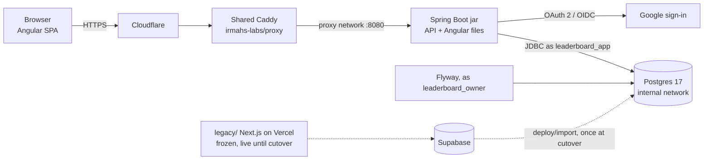
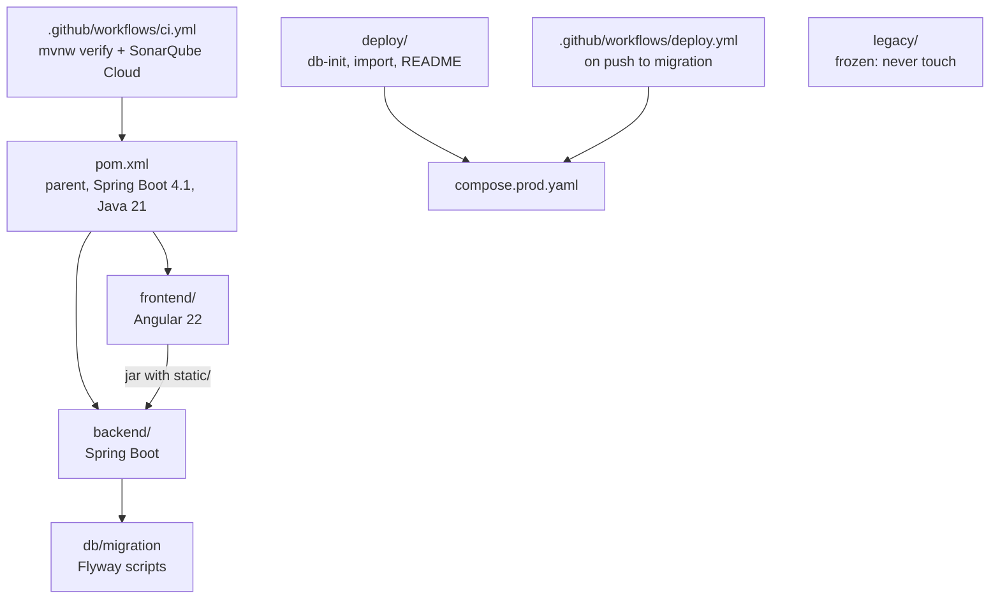
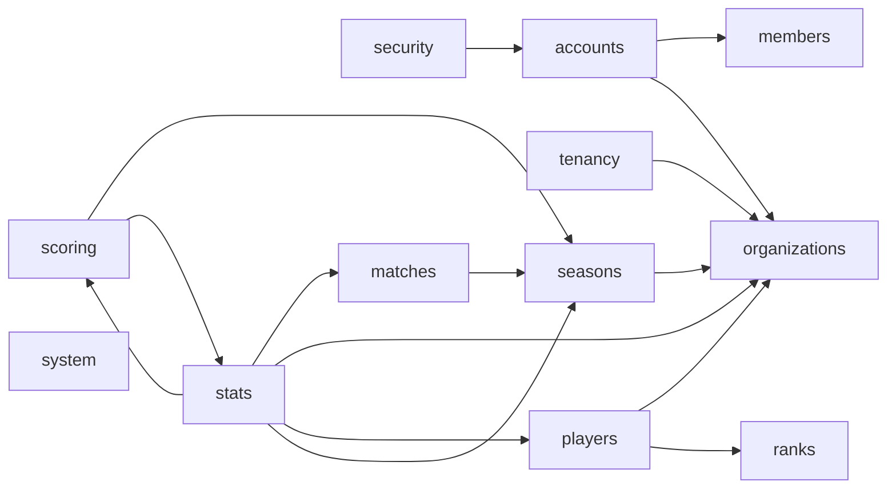
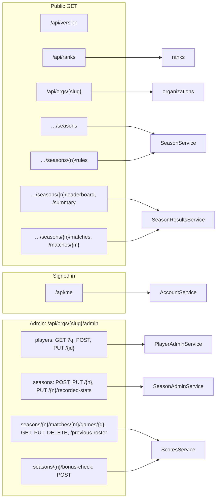
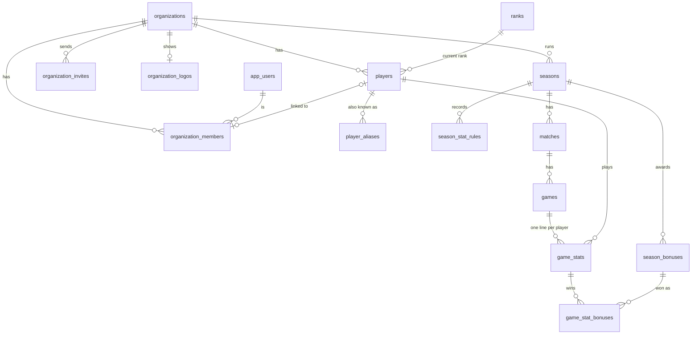
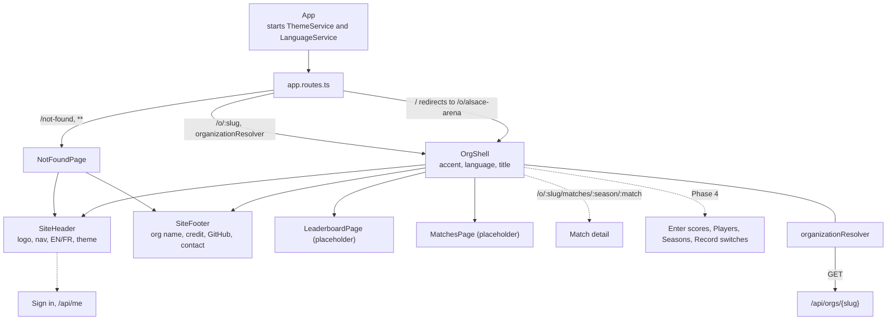

# Context graph

A map of the rewrite: what each part is, what it depends on, and what's built so far. Keep it
current: any pull request that adds, removes or reconnects a package, endpoint, table, screen,
workflow or phase updates this file in the same pull request.

Last updated: 2026-11-17, with the Angular shell (Phase 3, first pull request).

## System

## Repository

## Backend packages

`dev.irmahs.leaderboard.*`. An arrow means "imports from".

| Package | Holds |
|---|---|
| `accounts` | `AppUser`, `GoogleProfile`, `AccountService` (sign-in, initial memberships, platform admins), `AccessProperties`, `MeController` |
| `members` | `OrganizationMember` (role ADMIN or PLAYER, one owner), `Membership` |
| `organizations` | `Organization`, `OrganizationService` (`requireActive`, `recordActivity`), public org endpoint |
| `security` | `SecurityConfig` (CSRF for SPAs, 401 on `/api/**`), `GoogleUserService` (verified email only), `OrgAccess` (`@orgAccess.isAdmin`) |
| `tenancy` | `OrganizationScopeFilter` + `OrganizationScopedTransactionManager`: sets `app.organization_id` per transaction for row-level security |
| `players` | `Player`, `PlayerAlias`, `AliasKind`, `PlayerAdminService` (search, add, edit; rename keeps the old Riot ID as an alias) |
| `ranks` | `Rank`, public rank list |
| `seasons` | `Season` (rules, bonuses, shape), `Stat` (`isCountable`), `StatRule`, `SeasonBonus`, `PlatformDefaults`, `SeasonService` (public), `SeasonAdminService` |
| `matches` | `Match`, `Game` and their repositories |
| `scoring` | `ScoringService` (the only place totals are computed), `BonusCalculator` (HIGHEST/LOWEST, ties all win) |
| `stats` | `GameStat`, `StatLine`, `PlayerTally`, `SeasonResultsService` (public results), `ScoresService` (Enter scores) |
| `system` | `/api/version`; `SpaController` forwards the Angular router's addresses (`/o/**`, `/not-found`, `/sign-in`) to `index.html` |

## API

Admin routes need `@orgAccess.isAdmin(#slug, authentication)` and a CSRF token on changes.

## Data model

Flyway: `V2026_11_10_1__schema.sql` (all tables), `V2026_11_13_1__row_level_security.sql`
(policy `organization_isolation` on players, seasons, matches, organization_members,
organization_invites and organization_logos).

No entity yet: `organization_invites`, `organization_logos`. Mapped as collections rather than
entities: `season_stat_rules` (a map on `Season`) and `game_stat_bonuses` (a many-to-many on
`GameStat`).

## Frontend

`frontend/src/app`. Solid arrows exist; dashed ones are planned.

| Part | Holds |
|---|---|
| `core/colour.ts` | WCAG contrast and mixing: the text colour on the accent and a readable accent text per theme |
| `core/theme.ts` | `ThemeService`: dark or light (system setting until the visitor picks; remembered), sets the accent CSS variables |
| `core/language.ts` | `LanguageService`: EN or FR through Transloco; the visitor's pick wins over the organisation's default |
| `core/organization.ts` | `OrganizationService`, `organizationResolver` (an unknown organisation shows Not found at the same address) |
| `layout/` | `OrgShell`, `SiteHeader`, `SiteFooter`, page layout |
| `pages/` | `NotFoundPage`; placeholders for the leaderboard and matches |
| `styles.css` | The template's tokens for both themes, Barlow fonts (bundled from `@fontsource`), shared classes |
| `public/i18n/` | `en.json`, `fr.json` |

Not in the shell yet: the online count (no backend), social links (branding API, phase 7),
sign-in (next pull request).

## Phases

```mermaid
flowchart LR
    p0[0 Setup ✓] --> p1[1 Schema, import, public API ✓] --> p2[2 Sign-in and admin API ✓]
    p2 --> p3[3 Angular shell and public pages ▶] --> p4[4 Angular admin] --> p5[5 Deploy pipelines] --> p6[6 Cutover]
    p6 --> p7[7 Open the platform<br/>release 2]
    p7 --> p8[8 Scoring rules editor] --> p9[9 Players and claims] --> p10[10 Seasons, matches<br/>and waiting lists]
    p10 --> p11[11 Exports and poster] --> p12[12 Moderation] --> p13[13 Merge tool and scan]
```

✓ done · ▶ next. The full plan, with each phase's exit criterion, is the migration plan page
kept with the project designs.

Not built yet: the online count (no phase yet; needs a backend before the header shows it);
social links, branding, members and invites (7); the scoring-rules editor,
`PUT …/rules?apply=current|next` (8); claims and expected emails (9); schedule and sign-ups (10);
exports (11); moderation (12); merging duplicate players (13).
