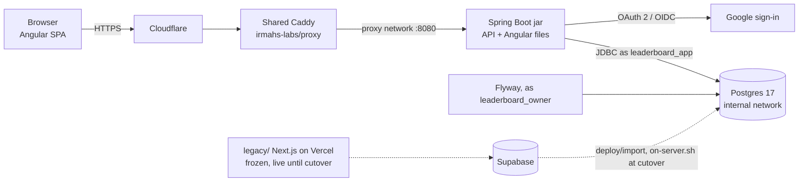
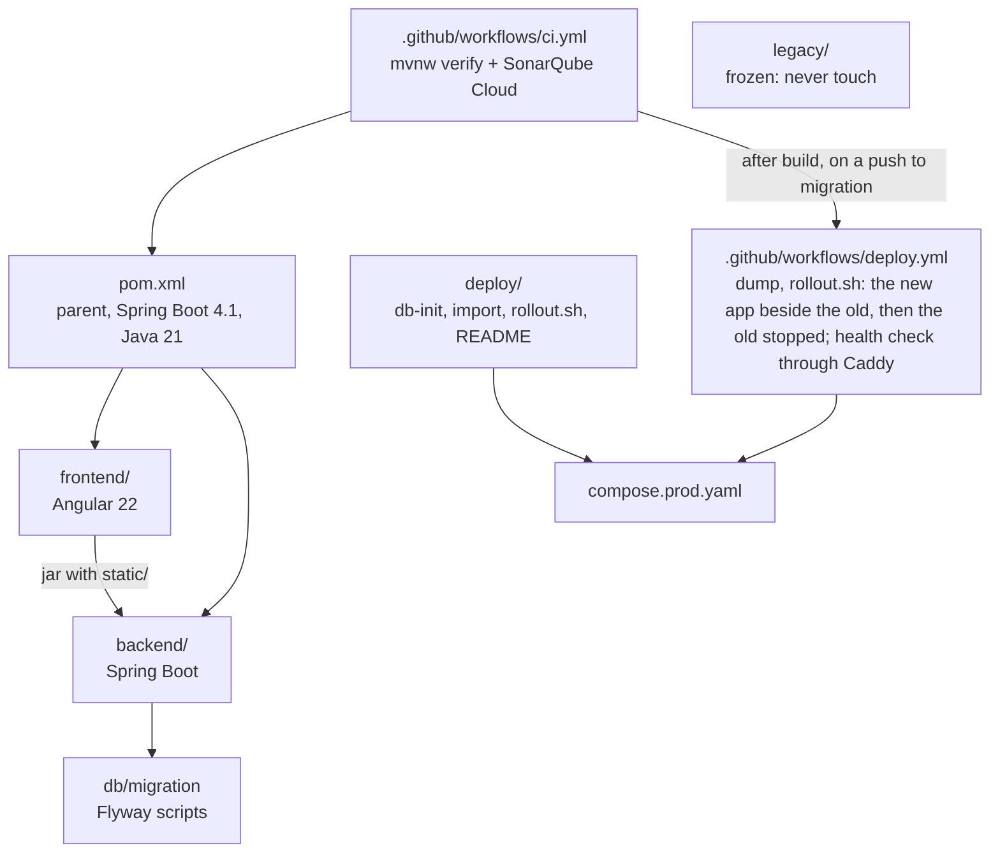
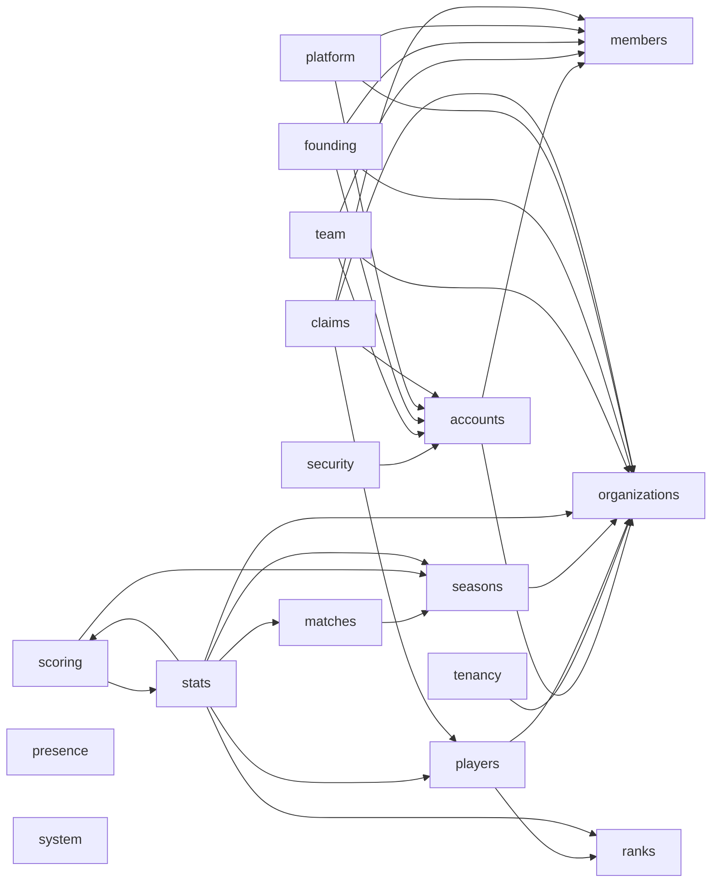
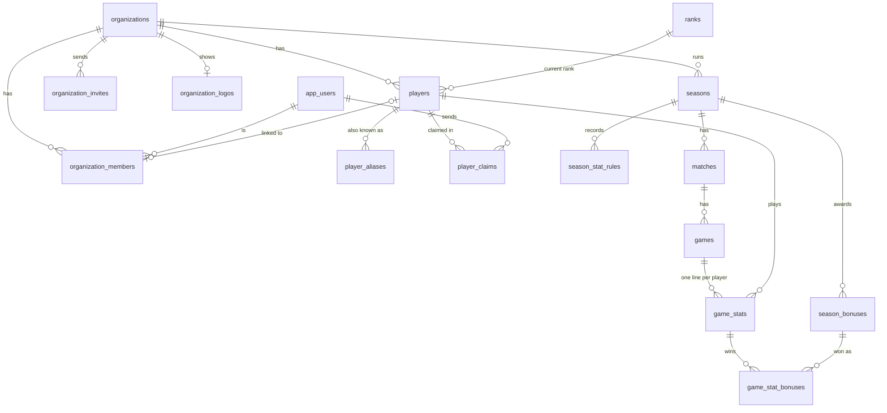

# Context graph

A map of the rewrite: what each part is, what it depends on, and what's built so far. Keep it
current: any pull request that adds, removes or reconnects a package, endpoint, table, screen,
workflow or phase updates this file in the same pull request.

Last updated: 2026-11-20, with the Riot ID and Discord kept on the account and shared by every linked profile (`PUT /api/me/identity`), and a linked player changing only their rank per organisation.

## System



## Repository



## Backend packages

`dev.irmahs.leaderboard.*`. An arrow means "imports from".



| Package | Holds |
|---|---|
| `accounts` | `AppUser`, `GoogleProfile`, `AccountService` (sign-in, initial memberships, platform admins, linking a player whose expected email matches, deleting an account unless it owns an organisation), `AccessProperties`, `IdentityService` (the account's Riot ID and Discord: changed on every linked profile at once, given to a profile when it's linked, taken from the first one), `MeController` (`GET` and `DELETE /api/me`, signing out after a deletion; `PUT /api/me/identity`) |
| `members` | `OrganizationMember` (role ADMIN or PLAYER, one owner), `Membership` |
| `organizations` | `Organization` (with its `SocialLinks`), `OrganizationService` (`requireActive`, `recordActivity`), `OrganizationView`, `BrandingService` (names, language, accent, places per match, links checked by `SocialSite`; the logo, told apart by its bytes), `OrganizationLogo`, the public org and logo endpoints, `BrandingController` |
| `security` | `SecurityConfig` (CSRF for SPAs, 401 on `/api/**`, Google sign-in ending on the Angular `/sign-in`), `GoogleUserService` (verified email only), `OrgAccess` (`@orgAccess.isAdmin`) |
| `tenancy` | `OrganizationScopeFilter` + `OrganizationScopedTransactionManager`: sets `app.organization_id` per transaction for row-level security |
| `players` | `Player`, `PlayerAlias`, `AliasKind`, `PlayerAdminService` (search, add, edit, a Google email expected in advance seen by admins only; `rerank` for a linked player; a linked player's Riot ID and Discord are refused to admins (409) and the list marks them `linked`; rename keeps the old Riot ID as an alias), `PlayerController` (the public list: Riot ID, Discord, aliases) |
| `ranks` | `Rank`, public rank list |
| `seasons` | `Season` (rules, bonuses, shape, KDA points), `Stat` (`isCountable`; `PLACE` and `HONOURS` among them), `StatRule` (recorded, points per unit), `SeasonBonus`, `BonusAward` (HIGHEST, LOWEST, MANUAL, TOP_WINNER, TOP_LOSER, AT_LEAST), `PlatformDefaults`, `Points` (points as the API writes them), `RulesSnapshot` (a season's rules on their own), `NextSeasonRules` (rules kept for the next season, as JSON) and `NextSeasonRulesController`, `SeasonService` (public), `SeasonAdminService` |
| `matches` | `Match`, `Game` and their repositories |
| `scoring` | `ScoringService` (the only place points are computed: per game, a match or season adding up its games; a stat not recorded doesn't count), `BonusCalculator` (HIGHEST/LOWEST, MVP/SVP from the place, AT_LEAST; ties all win; nothing from a stat not recorded) |
| `stats` | `GameStat`, `StatLine`, `PlayerTally`, `SeasonResultsService` (public results; each standing carries the player's current rank), `ScoresService` (Enter scores), `RulesAdminService` (the Scoring screen: changes a season's rules and works out every saved game's automatic bonuses again; adds the admins' own bonuses, coded from their name, and removes bonuses with their awards; a finished season's rules can't change) |
| `founding` | `FoundingService` (anyone signed in creates an organisation and owns it: address checked and not reserved, 3 owned at most except for platform admins, 409 when taken), `FoundingController` |
| `platform` | `PlatformService` (platform admins only: every organisation with its owner, members, activity and whether the home page features it; suspending and reactivating), `PlatformController` |
| `claims` | `PlayerClaim` (player_claims), `ClaimService` (join as a player; claim an unclaimed player with a note; cancel; the admins' queue; accepting links the member and declines the other claims for that player; nobody accepts their own while another admin exists, the only admin's is marked self-approved; the linked player edits their own details), `ClaimController` |
| `team` | `Invite` (organization_invites; only a hash of the code), `InviteCodes` (8 characters without look-alikes, SHA-256), `TeamService` (the Members screen: roles, removal, ownership, admin invites), `JoinService` (what a code is for; using it, its row locked), `MembershipController` (leaving an organisation, never as its owner), `CodeLookupLimit` (10 lookups a minute per address, in memory) |
| `presence` | `OnlineCount` (open pages, in memory only; changes sent at most once a second, a heartbeat every 25 s), `GET /api/online` as server-sent events |
| `system` | `/api/version`; `SpaController` forwards the Angular router's addresses (`/org/**` (the claim page included), `/not-found`, `/platform`, `/account`, `/join`, `/join/*`, `/sign-in`, `/legal`, `/privacy`, `/cookies`, `/terms`) to `index.html` |

## API

Admin routes need `@orgAccess.isAdmin(#slug, authentication)` and a CSRF token on changes.

```mermaid
flowchart LR
    subgraph public[Public GET]
        v["/api/version"]
        on["/api/online (event stream)"]
        r["/api/ranks"]
        fe["/api/featured: the most recently active organisation, 204 before any game"]
        o["/api/orgs/{slug}"]
        lo["/api/orgs/{slug}/logo: kept a year, its address changes with it"]
        sl["…/seasons"]
        sr["…/seasons/{n}/rules"]
        lb["…/seasons/{n}/leaderboard, /summary"]
        ml["…/seasons/{n}/matches, /matches/{m}"]
        ps["…/seasons/{n}/players/{id}: a player's season match by match"]
        pl2["/api/orgs/{slug}/players"]
    end
    subgraph signedin[Signed in]
        me["/api/me: GET, DELETE (delete my account); /api/me/identity: PUT (Riot ID and Discord everywhere)"]
        lv["/api/orgs/{slug}/membership: DELETE (leave)"]
        acc["/api/invites/{code}/accept: POST"]
        fo["/api/orgs: POST, create an organisation"]
        cl["/api/orgs/{slug}/membership: POST (join); /claim: GET, POST, DELETE; /claim/players: GET; /claim/player: PUT (my rank here)"]
        pl["/api/platform/organizations: GET; /{slug}/status: PUT (platform admins)"]
    end
    jv["/api/invites/{code}: GET, public, 10 a minute"]
    subgraph admin["Admin: /api/orgs/{slug}/admin"]
        ap["players: GET ?q, POST, PUT /{id}"]
        br["branding: PUT; logo: PUT (the image as the body), DELETE"]
        cq["claims: GET ?status=, POST /{id}/accept, POST /{id}/decline"]
        tm["members: GET, PUT /{user}/role, DELETE /{user}, POST /{user}/ownership; invites: POST, DELETE /{id}"]
        as["seasons: POST, PUT /{n}"]
        ru["seasons/{n}/rules: PUT ?apply=current|next, POST /platform-defaults, POST /bonuses, DELETE /bonuses/{code}"]
        nx["next-season-rules: GET, DELETE"]
        sc["seasons/{n}/matches/{m}/games/{g}: GET, PUT, DELETE, /previous-roster"]
        bc["seasons/{n}/bonus-check: POST"]
    end
    r --> ranks
    on --> presence
    o & lo & br --> BrandingService
    sl & sr --> SeasonService
    lb & ml & ps --> SeasonResultsService
    pl2 --> players
    me --> AccountService
    lv --> TeamService
    fe --> BrandingService
    fo --> FoundingService
    cl & cq --> ClaimService
    pl --> PlatformService
    tm --> TeamService
    jv & acc --> JoinService
    ap --> PlayerAdminService
    as --> SeasonAdminService
    sc & bc --> ScoresService
    ru --> RulesAdminService
    nx --> NextSeasonRules
```



## Data model

Flyway: `V2026_11_10_1__schema.sql` (all tables), `V2026_11_13_1__row_level_security.sql`
(policy `organization_isolation` on players, seasons, matches, organization_members,
organization_invites and organization_logos), `V2026_11_18_1__drop_avatar_url.sql` (the Google
picture isn't kept: data minimisation), `V2026_11_19_1__weighted_scoring.sql`,
`V2026_11_19_2__social_links.sql` (six `*_url` columns on organizations, https only),
`V2026_11_20_1__player_claims.sql` (player_claims, one waiting per member, with the same policy),
`V2026_11_20_2__expected_email.sql` (players.expected_email, once per organisation), `V2026_11_20_3__account_identity.sql` (app_users.riot_id and discord_username, filled from each linked account's first profile).



Mapped as collections rather than
entities: `season_stat_rules` (a map on `Season`) and `game_stat_bonuses` (a many-to-many on
`GameStat`).

## Frontend

`frontend/src/app`, organised by feature like the backend: `shared/` for what every feature uses,
`layout/` for the two shells, then one folder per feature. Solid arrows exist; dashed ones are
planned.

```mermaid
flowchart TD
    app[App<br/>starts ThemeService, LanguageService, SessionService] --> routes[app.routes.ts]
    routes -->|"/org/:slug, organizationResolver"| shell[OrgShell<br/>accent, language, title, season]
    routes -->|"/, /account, /platform, /sign-in, /join, /join/:code, /legal, /privacy, /cookies, /terms, /not-found, **"| platform[PlatformShell<br/>platform name and red]
    platform --> home[HomePage /<br/>what it does, create an organisation, the featured one]
    home -->|"GET /api/featured, POST /api/orgs"| foundApi["/api/featured, /api/orgs"]
    platform --> padmin[PlatformPage /platform, platformGuard<br/>counts, search, every organisation, suspend or reactivate]
    padmin -->|"GET, PUT …/status"| platformApi["/api/platform/organizations"]
    platform --> acct[AccountPage /account, accountGuard<br/>profile, Riot ID and Discord for every organisation, sign out, organisations and leaving, deleting the account]
    acct -->|"PUT /api/me/identity, DELETE /api/me, DELETE …/membership"| accountApi["/api/me, /api/orgs/{slug}/membership"]
    platform --> si[SignInPage<br/>Google, your organisations, sign out, create one]
    platform --> legal[LegalPage<br/>legal notice, privacy, cookies, terms]
    platform --> nf[NotFoundPage]
    platform --> join[JoinPage /join/:code<br/>what the code is for, sign in with the invited account, accept; or type a code]
    shell --> header[SiteHeader<br/>skip link, logo, nav keeping ?season= (Scores, Players, Seasons, Scoring, Members and Branding on admin pages; a Site | Admin switch for admins), online count, season, one EN / FR button, a light/dark pill switch, Sign in or My account]
    shell --> footer[SiteFooter<br/>org name and its social links; credit, legal pages, GitHub and Contact on three centred lines]
    platform --> header
    platform --> footer
    shell -->|"organisation, ?season="| current[CurrentSeason]
    current -->|GET| seasonsApi["…/seasons"]
    header -->|season picker| current
    si -->|"leaves for"| google["/oauth2/authorization/google"]
    google -->|"back to /sign-in, then the page sign-in began on"| si
    header -->|event stream| online[OnlineService] -->|GET| onlineApi["/api/online"]
    header --> session[SessionService] -->|GET /api/me, POST /api/logout| meApi["/api/me"]
    shell --> lb["LeaderboardPage<br/>top three, tiles, how points are counted"]
    lb --> table[StandingsTable]
    lb --> current
    lb -->|GET| lbApi["…/seasons/{n}/leaderboard, /summary, /rules"]
    table --> pill[RankPill]
    lb --> pill
    shell -->|"/org/:slug/players"| plp["PlayersPage<br/>a card per player, search, sort, rank filter"]
    shell -->|"/org/:slug/claim, accountGuard"| clp["ClaimPage<br/>join, pick your profile, note, wait or cancel"]
    shell -->|"/org/:slug/players/:player?season="| pp["PlayerPage<br/>standing, the player ahead, averages, points per match, matches; on one's own, You and My rank"]
    shell -->|"/org/:slug/matches"| mt["MatchesPage<br/>a card per match, its MVP"]
    mt --> current
    mt -->|GET| mtApi["…/seasons/{n}/matches"]
    shell -->|"/org/:slug/matches/:match?season="| md["MatchPage<br/>MVP, stat leaders, games, overall or one game, averages or totals"]
    md --> current
    md --> table
    md -->|GET| mdApi["…/seasons/{n}/matches/{m}"]
    shell -->|"/org/:slug/admin, adminGuard"| guard[adminGuard<br/>admins and platform admins; others to sign-in or the public pages]
    guard --> sadm["ScoresAdminPage /admin/scores?season=&match=&game=<br/>one game at a time, previous game's players, check bonuses"]
    sadm -->|"GET, PUT, DELETE, /previous-roster, POST bonus-check"| scoresApi["…/admin/seasons/{n}/matches/{m}/games/{g}"]
    sadm -->|GET| sadmApi["…/seasons/{n}/rules, /matches; …/admin/players"]
    sadm --> current
    guard --> padm["PlayersAdminPage /admin/players<br/>add, search, edit inline"]
    padm -->|GET ?q, POST, PUT| playersApi["…/admin/players"]
    padm -->|GET| ranksApi["/api/ranks"]
    padm --> pill
    guard --> seadm["SeasonsAdminPage /admin/seasons<br/>list, edit inline (close, reopen), start the next season"]
    seadm -->|POST, PUT /n| seasonsAdminApi["…/admin/seasons"]
    guard --> scadm["ScoringAdminPage /admin/scoring?season=<br/>Record switches, points per stat, KDA, win, bonuses (add, remove), formula preview, apply to this season or the next only"]
    scadm -->|"GET …/rules, PUT, POST /platform-defaults, POST and DELETE /bonuses"| recordApi["…/admin/seasons/{n}/rules"]
    guard --> madm["MembersAdminPage /admin/members<br/>invite an admin, waiting invites, roles, remove, ownership"]
    madm -->|"GET, PUT, POST, DELETE"| teamApi["…/admin/members, …/admin/invites"]
    guard --> cadm["ClaimsAdminPage /admin/claims<br/>Waiting, Accepted, Declined; accept, decline with a reason"]
    guard --> badm["BrandingAdminPage /admin/branding<br/>names, language, logo, accent with its contrast, places per match, social links"]
    badm -->|"PUT, DELETE; then CurrentSeason.show"| brandApi["…/admin/branding, …/admin/logo"]
    seadm --> current
    scadm --> current
    resolver[organizationResolver] -->|GET| orgApi["/api/orgs/{slug}"]
    shell --- resolver
```

| Folder | Holds |
|---|---|
| `shared/` | `ThemeService` (dark or light, the accent's CSS variables), `colour.ts` (WCAG contrast and mixing, the palettes, readable rank colours), `LanguageService` (EN or FR; numbers, dates and plurals in the language on screen), `OnlineService` (the header's count of open pages), `SessionService` (who is signed in, `canAdmin`, `meOrSignIn` for the guards, one `/api/me` request at a time, Google sign-in with a safe return address, sign-out), `organization.ts` (`organizationResolver`, `fullName`, `initials`), `storage.ts` (local and session storage that survives being blocked), `RankPill` |
| `layout/` | `OrgShell` (an organisation's pages), `PlatformShell` (sign-in and Not found), `SiteHeader`, `SiteFooter`, page layout |
| `results/` | The public results: `api.ts` (the API's shapes), `CurrentSeason` (the organisation's seasons, newest first, the one picked with `?season=`, `reload()` after an admin change, `adminApi` (the admin pages' API address), `show()` for the organisation after Branding saves it; its seasons are fetched by slug only), `stats.ts` (stat columns with K, D and A folded into KDA, decimals, the points formula, Riot ID name and tag), `StandingsTable` (a season's or a match's averages or totals, or one game's lines), `leaderboard/`, `matches/` (`MatchesPage`), `players/` (`PlayersPage`; `players-list.ts`: cards, search, sorts, tiers), `player/` (`PlayerPage`, `barsOf`, `kdaOf`), `match/` (`MatchPage`, `match-stats.ts`: a game's lines as standings, the stat leaders) |
| `admin/` | `adminGuard`, `api.ts` (the admin API's shapes), `players/` (`PlayersAdminPage`: aliases typed as one line, a previous Riot ID keeps its kind), `action.ts` (`AdminAction`: one change at a time, then a status line), `seasons/` (`SeasonsAdminPage`, `problemOf` checking details as the API does), `scoring/` (`ScoringAdminPage`: the rules as typed, `problemOf` and `inputOf`, `previewOf` for the formula, `newBonusProblem` and `newBonusInput`; locked for a finished season), `members/` (`MembersAdminPage`, the invite message to copy), `claims/` (`ClaimsAdminPage`), `branding/` (`BrandingAdminPage`, `problemOf` and `linkAllowed` checking as the API does), `scores/` (`ScoresAdminPage`; `scores-form.ts`: lines as typed, stat boxes parsed with a decimal comma, an empty place taken from the line's number, the request) |
| `home/` | `HomePage` (the form kept in session storage across Google sign-in), `slugFrom`, `foundingProblem` |
| `platform/` | `PlatformPage`, `platformGuard` (platform admins only; others see Not found), `matching` (search by name, address or owner's email) |
| `account/` | `AccountPage` (Riot ID and Discord for every organisation, typing DELETE to delete), `accountGuard` (signed in only) |
| `claim/` | `ClaimPage`, `api.ts` (claims' shapes, `matchingPlayers`) |
| `sign-in/` | `SignInPage` |
| `join/` | `JoinPage`, `stepOf` (sign in, accept, wrong account, expired, used, revoked, accepted), `tidyCode` |
| `legal/` | `LegalPage` and `legal-content.ts`: the legal notice, privacy policy, cookie policy and terms, in English and French, one route each |
| `not-found/` | `NotFoundPage` |
| `testing.ts` | Fixtures and helpers shared by the tests (`openAlsace`, `answer`, `text`) |
| `styles.css` | The template's tokens for both themes, Barlow fonts (bundled from `@fontsource`), shared classes (`.panel`, `.pill`, `.heading`, `.lede`, `.label`, buttons) |
| `public/i18n/` | `en.json`, `fr.json` |
| `public/` | `robots.txt`, and `llms.txt` describing the public API for AI agents |

A component used by several features lives in `shared/` (`RankPill`); one used by several pages of a
single feature lives in that feature (`StandingsTable` in `results/`).

Not on the leaderboard yet: Export CSV and Export poster (phase 11).

## Phases

```mermaid
flowchart LR
    p0[0 Setup ✓] --> p1[1 Schema, import, public API ✓] --> p2[2 Sign-in and admin API ✓]
    p2 --> p3[3 Angular shell and public pages ✓] --> p4[4 Angular admin ✓] --> p5[5 Deploy pipelines ✓] --> p6[6 Cutover ✓]
    p6 --> p7[7 Open the platform<br/>release 2 ✓]
    p7 --> p8[8 Scoring rules editor ✓] --> p9[9 Players and claims ✓] --> p9b[9b Deploys players<br/>don't notice ▶]
    p9b --> p10[10 Seasons, matches<br/>and waiting lists] --> p10b[10b Help]
    p10b --> p11[11 Exports and poster] --> p12[12 Moderation] --> p13[13 Merge tool and scan]
```



✓ done · ▶ next. Until the switch-over (6), every merge into `migration` that passes CI deploys
production, and the Protect migration ruleset lets a pull request merge only once Build and test
(quality gate included) has passed; version tags, a staging copy from `main` and release-please
come with it. The full plan, with each phase's exit criterion, is the migration plan page
kept with the project designs.

Phases 7, 8 and 9 are built; not built yet: schedule and sign-ups (10);
exports (11); moderation (12); merging duplicate players (13).
